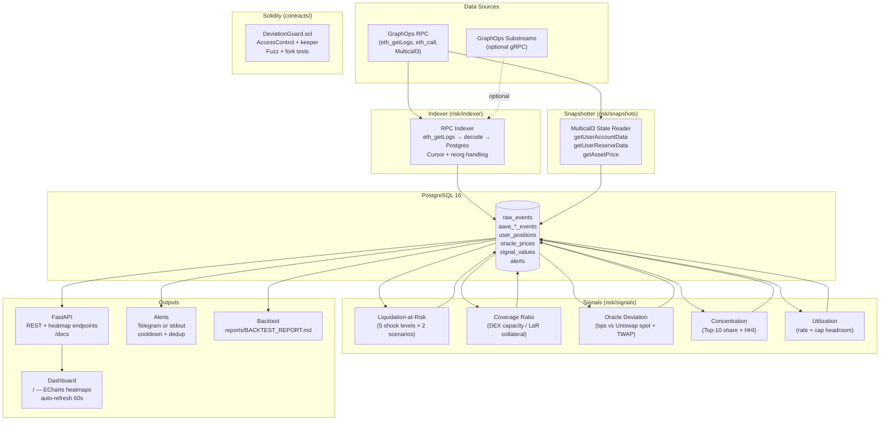

# Aave Collateral Stress Monitor

For each collateral asset in Aave v3 Ethereum, how much debt becomes liquidatable under a price shock, and is there enough on-chain DEX liquidity to actually liquidate it?

This project is a production-quality miniature of [LlamaRisk](https://llamarisk.com)'s risk-monitoring infrastructure: event indexing, on-chain state reads, risk signal computation, backtesting, a live dashboard, and an on-chain circuit-breaker demonstration contract.

---

## Architecture



---

## Quick Start

### Prerequisites
- Docker + Docker Compose
- Python 3.12 + [uv](https://docs.astral.sh/uv/)
- Foundry (`curl -L https://foundry.paradigm.xyz | bash && foundryup`)
- A GraphOps API key (see [graphops.xyz](https://graphops.xyz))

### 1. Configure

```bash
cp .env.example .env
# Edit .env and set:
#   GRAPHOPS_API_KEY=your_key
#   GRAPHOPS_RPC_URL=https://mainnet.gateway.tenderly.co  (or GraphOps RPC)
```

### 2. Start Postgres

```bash
make up          # starts Postgres in Docker
make migrate     # applies SQL migrations
```

### 3. Backfill + snapshot

```bash
make backfill    # index events from head-90 days (uses RPC credits)
make snapshot    # take a live position snapshot
make signals     # compute all risk signals
```

### 4. Run the API

```bash
make api
# Dashboard at http://localhost:8000
# API docs at http://localhost:8000/docs
```

### 5. Backtest

```bash
make backtest    # writes reports/BACKTEST_REPORT.md
```

### 6. Contracts

```bash
make contracts-test  # runs 24 Foundry tests including fuzz
```

### 7. Full CI

```bash
make lint typecheck test contracts-test
```

---

## Configuration

All settings in `.env` (see `.env.example`).  Validated at startup by pydantic; process
exits with a clear error if required fields are missing.

| Variable | Default | Description |
|----------|---------|-------------|
| `GRAPHOPS_API_KEY` | — | Required for authenticated RPC |
| `GRAPHOPS_RPC_URL` | tenderly mainnet | Ethereum mainnet JSON-RPC |
| `DATABASE_URL` | — | PostgreSQL DSN |
| `BACKFILL_DAYS` | 90 | Days of history to index |
| `MAX_RPC_CALLS_PER_RUN` | 50000 | Credit budget per run |
| `CONFIRMATIONS` | 12 | Blocks before marking as final |
| `TELEGRAM_BOT_TOKEN` | — | Optional; logs to stdout if unset |

---

## What Was Built

- **Indexer**: `eth_getLogs`-based event indexer for Aave v3 Pool (Supply, Withdraw, Borrow, Repay, LiquidationCall, ReserveDataUpdated), Chainlink AnswerUpdated, and Uniswap v3/Curve Swap events. Resumable cursor, reorg handling, finality marking.
- **Snapshotter**: Multicall3-batched position reader (`getUserAccountData`, `getUserReserveData`, `getAssetPrice`, `getReserveConfigurationData`). Credit budget enforcement.
- **5 risk signals**: Liquidation-at-Risk, Coverage Ratio, Oracle Deviation, Concentration, Utilization.
- **Backtest engine**: Replays signals over historical snapshots; writes `BACKTEST_REPORT.md`.
- **FastAPI**: 10 endpoints including 3 heatmap endpoints; Pydantic response models; OpenAPI at `/docs`.
- **Dashboard**: Single-page ECharts dark-theme dashboard with LaR heatmap, HF distribution, oracle deviation, DEX coverage, alerts, and backtest summary.
- **Alerts**: Telegram or stdout; 6-hour cooldown per signal+asset; "resolved" notifications.
- **DeviationGuard.sol**: 115-line Solidity circuit breaker with AccessControl, 24 Foundry tests (access control, boundary rounding, consecutive logic, fuzz, mainnet fork).
- **CI**: GitHub Actions lint + mypy + pytest + forge test + Docker build.

## What Was Changed or Cut

- **Substreams via gRPC**: Implemented via RPC fallback instead (see `DECISIONS.md`).
- **USDe**: Not listed in Aave v3 Ethereum Core as of writing; excluded with `TODO(verify)`.
- **Market-wide shock multi-asset decomposition**: Simplified (see `DECISIONS.md`).
- **Curve DEX capacity**: Stub implemented; `get_dy` integration present but not binary-searched.
- **Oracle deviation USD conversion**: Uses normalised relative comparison; full USD conversion needs WETH/USD oracle (noted in `REVIEW_CHECKLIST.md`).

## Known Issues

1. `reports/RECONCILIATION.md` and `reports/BACKTEST_REPORT.md` show placeholders until `make backfill && make snapshot && make backtest` have been run with a live API key.
2. The dashboard shows "No data" until a snapshot has completed.
3. DEX pool addresses in `config/assets.yaml` require on-chain verification (marked `TODO(verify)`).
4. The Curve pool address for wstETH needs confirmation (see `config/assets.yaml`).
